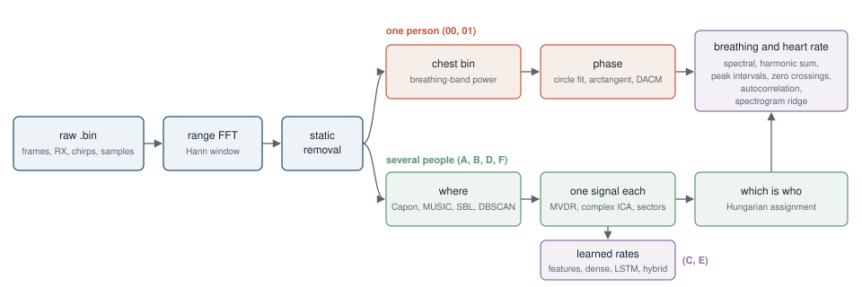

# Radar-signal-processing



Contactless breathing and heart rate with a 60 GHz FMCW radar (TI IWR6843AOP), for one person and for several people in front of the same radar. This is the processing code behind my radar work on SiViS, our recordings of up to three patient simulators in different clinical states, lying side by side and seen from several radar positions.

The methods are kept as I developed them, A to F. Each notebook puts the theory, the code and a figure next to each other. The figures come from a simulated scene where the true chest motion is known, so they show what a step does, not how well it performs; results on recorded data are in the papers below.

## One person, several people

With one person the problem is one-dimensional. The chest occupies one range bin, the phase of that bin follows the chest wall to a fraction of a millimetre (2.5 rad per mm at 60 GHz), and the work is in two places: removing the static echoes that share the bin before the phase is demodulated, and reading two rates that overlap, because breathing is not a sinusoid and its harmonics reach into the heart band.

With several people three things change. Two chests can fall in the same range bin, and the AOP has only four virtual elements along azimuth, so a delay-and-sum beam is about 28° wide and a person 25° away still leaks into it. The static echoes of two people in one bin are coherent, which breaks subspace methods unless the snapshots are taken from what moves. And the beams come out in map order, so something has to decide which beam belongs to which person. Methods A to F are different answers to these three problems.

## Notebooks

- [00 Signal model](methods/00_signal_model.ipynb). Beat frequency and phase of an FMCW echo, range resolution of the sampled sweep, the radar cube, the AOP virtual array with TI's geometry and feed polarity, and the simulated scene.
- [01 One person](methods/01_one_person.ipynb). Choosing the chest bin by breathing-band power, arctangent demodulation around a fitted circle centre, DACM, phase against phase rate against amplitude, six rate finders and how each one fails, Goertzel checks of candidate rates.
- [A Range-angle map and MVDR beams](methods/A_mvdr_beams.ipynb). The chain used to validate SiViS. FFT and covariance range-angle maps, target picking with a physical spacing rule, MUSIC on breathing-band snapshots for two people in one bin, MVDR beams with diagonal loading, joint assignment of breathing and heart rate to people.
- [B Gated beams and ICA](methods/B_beams_ica.ipynb). How much a fixed beam leaks, why the leak is not linear in the phase, complex FastICA on the channels of one range gate as blind beamforming, and a family of breathing-rate finders fused by their median on sliding windows.
- [C Spectrogram ridge and learning](methods/C_ridge_learning.ipynb). Breathing tracked through a recording by dynamic programming on a spectrogram after a cardiac notch; beam features, dense, LSTM and hybrid models, and why they have to be evaluated by recording.
- [D Localisation](methods/D_localisation.ipynb). Four ways to find the people: strongest range bins, DBSCAN on a range-angle map of breathing-band power, MUSIC, and multiple-snapshot sparse Bayesian learning.
- [E Feature network](methods/E_feature_network.ipynb). A small dense network with batch normalisation, dropout and a Huber loss, and what mixup assumes when the target is a rate.
- [F Range-Doppler map and fixed beds](methods/F_range_doppler.ipynb). Why a chest never leaves the zero-velocity column of a Doppler FFT, range sectors per person, and fixed beams to known bed positions (Method 4).

## The package

The notebooks import `radar`, which also runs on the raw files:

```
radar/
  sivis.py       file names, condition table, .bin reader (SiViS and DCA1000 layouts)
  cube.py        chirp settings, range and Doppler FFTs, static removal, TDM-MIMO channels, AOP and ISK layouts
  spatial.py     steering vectors, Bartlett, Capon, MUSIC, range-angle maps, CFAR, picking, DBSCAN, M-SBL
  beams.py       delay-and-sum, MVDR and LCMV beams, fixed beds, range sectors
  vitals.py      circle fit, DACM, filters, rate finders, spectrogram ridge, Goertzel
  separation.py  ICA on beams, complex FastICA, empirical wavelet transform
  assign.py      matching estimates and people
  learn.py       beam features, Keras models, split by recording, mixup
  simulate.py    the scene simulator behind the figures
tests/           checks on simulated scenes and on the file reader
```

On a SiViS recording, Method A in a few lines:

```python
import numpy as np
from radar import sivis, cube, spatial, beams, vitals

name = "146_TopFront_4m_0deg_Man3_CondE_CondG_CondB_ADC256_Chirp128_SR1000_RE60_FR40_Gain30_FS30_IWR_0.bin"
info = sivis.parse_name(name)
raw = sivis.read_bin(name, n_samples=info["adc_samples"], n_chirps=info["chirps"])  # chirps per frame, all TX
rp = cube.compensate_aop(cube.virtual_channels(cube.range_fft(raw)))
cfg = cube.RadarConfig(slope=..., fs_adc=..., n_samples=info["adc_samples"], frame_rate=...)  # from the recording's configuration

pos, angles = cube.aop_positions(), np.arange(-60, 60.5, 0.5)
ra = spatial.range_angle_map(rp, pos, angles, "capon")
for r, a in spatial.pick_targets(ra, info["n_simulators"], cfg.range_resolution, angles):
    z = beams.mvdr_beam(rp, r, angles[a], pos)
    print(vitals.vital_rates(z, cfg.frame_rate, centre=vitals.circle_fit(z)[0]))
```

`pip install -r requirements.txt` installs NumPy, SciPy, scikit-learn and Matplotlib; TensorFlow is needed only for the models in `radar.learn`. `python -m pytest tests` runs the checks.

## Data

**SiViS** (Harvard Dataverse, [doi:10.7910/DVN/S9SNAK](https://doi.org/10.7910/DVN/S9SNAK)). IWR6843AOP recordings of one to three patient simulators, each set to a clinical condition, from top, top-front, top-side, frontal and side positions at 2 to 4 m. The set-up of each recording is written in its file name (`sivis.parse_name`). Please cite the SiViS paper if you use it.

The single-person steps also apply to other public recordings:

- Schellenberger et al., *Scientific Data* 7, 291 (2020), [doi:10.1038/s41597-020-00629-5](https://doi.org/10.1038/s41597-020-00629-5): 30 people, 24 GHz continuous-wave six-port radar, with ECG, impedance cardiography and blood pressure as reference. A CW radar has no range axis, so only notebook 01 applies, from the I/Q signal onwards.
- Wu et al., FMCW radar-based multi-person vital sign monitoring data, Mendeley Data (2024), [doi:10.17632/684v4r8wfr.1](https://doi.org/10.17632/684v4r8wfr.1): two people, IWR6843ISK with DCA1000, ECG reference. The ISK has a different antenna layout from the AOP: use `cube.isk_positions()` and skip `cube.compensate_aop`.

## Papers

- Reyes-Leiva KM, Gupta A, Grosmaire A, Cerny M. SiViS: Simulated multi-patient physiological clinical states for advanced vital sign radar monitoring research. *Scientific Data* (2026). [doi:10.1038/s41597-025-06449-9](https://doi.org/10.1038/s41597-025-06449-9)
- Reyes-Leiva KM, Gupta A, Cerny M. Radar placement effects on multi-patient heart and respiration monitoring: SiViS dataset validation. *Biomedical Engineering Systems and Technologies*, Springer (2026). [doi:10.1007/978-3-032-13312-0_11](https://doi.org/10.1007/978-3-032-13312-0_11)
- Reyes Leiva KM, Vondal M, Yang M, Cerny M, Wang Y. Estimating respiratory rate in freely moving users using independent component and multi-resolution analysis. *Computers in Biology and Medicine* (2025). [doi:10.1016/j.compbiomed.2025.110957](https://doi.org/10.1016/j.compbiomed.2025.110957)
- Gupta A, Reyes-Leiva KM, Cerny M. Multi-objective undercomplete independent component analysis for radar signals based heart rate and interbeat interval estimations. *IEEE EMBC* (2025). [doi:10.1109/EMBC58623.2025.11253136](https://doi.org/10.1109/EMBC58623.2025.11253136)
- Contactless multi-patient vital sign monitoring with a physics-based FMCW radar and Transformer framework (UST-Hybrid). Poster, *Redefining Healthcare in the Age of AI*, Sorbonne, Paris (2026).

Under review: lightweight ECG-guided knowledge distillation for cardio-informed radar signal reconstruction (CAR-Net), *Computers in Biology and Medicine*; a systematic review of reporting bias in deep learning-based vital sign estimation with radar, *Pattern Recognition*.

Karla Miriam Reyes Leiva · [drkarlareyes.github.io](https://drkarlareyes.github.io) · ORCID [0000-0002-3269-0830](https://orcid.org/0000-0002-3269-0830) · MIT licence
